+++
title = "AMI로 기존 서버를 복제해 새 EC2 만들기"
date = 2026-11-26
[taxonomies]
tags = ["aws", "ec2", "ami"]
+++

이 글은 기존 서버를 예시로, 아래 순서로 똑같은 서버를 하나 더 만드는 방법을 정리합니다.

1. 기존 서버에서 AMI(서버 이미지) 만들기
2. 그 AMI로 새 EC2 서버 만들기
3. 접속 확인
4. 서비스 동작 확인

> **AMI란?** 서버 전체(OS·설치된 프로그램·설정)를 통째로 떠놓은 '서버 사진'입니다. 이 사진으로 똑같은 서버를 몇 개든 복제할 수 있습니다.

> 모든 작업 전에, 화면 오른쪽 위 리전이 **서울(ap-northeast-2)**로 되어 있는지 확인하세요.

<!-- more -->

## 1단계 — 기존 서버에서 AMI 만들기

EC2 왼쪽 메뉴 **인스턴스**에서 복제할 서버를 선택(체크)한 뒤, 위쪽 **작업(Actions)** 버튼을 누릅니다. 메뉴에서 **이미지 및 템플릿 → 이미지 생성**을 클릭합니다.

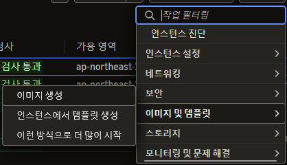

다음 화면에서 **이미지 이름**을 입력하고(예: MY-SERVER-AMI) **이미지 생성**을 누릅니다. 서버 용량에 따라 몇 분에서 수십 분 걸립니다. 이 동안에도 원본 서버는 계속 사용할 수 있습니다.

## 2단계 — 만들어진 AMI 확인하기

왼쪽 메뉴에서 **이미지 → AMI**를 클릭합니다.

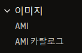

목록에서 **내 소유** 필터를 선택하면 방금 만든 AMI가 보입니다. **상태(Status)가 '사용 가능(available)'**이 될 때까지 기다립니다. 생성 중에는 'pending'으로 표시됩니다. 여기 보이는 **AMI ID**가 다음 단계에서 쓸 값입니다.

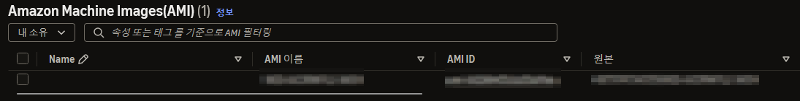

## 3단계 — AMI로 새 EC2 서버 만들기

준비된 AMI를 **체크**한 뒤, 오른쪽 위 **AMI로 인스턴스 시작** 버튼을 누릅니다.

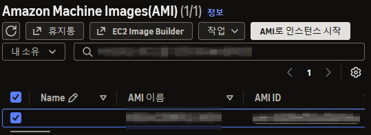

### 이름 입력

**이름**에 새 서버 이름을 적습니다. 역할과 환경이 드러나는 이름을 권장합니다(예: MY-WEB-SERVER-01).

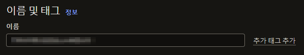

### AMI 확인

**애플리케이션 및 OS 이미지**에서 **내 AMI** 탭에 방금 그 AMI가 선택돼 있는지, 이미지 ID가 맞는지 확인합니다. 여기는 이미 채워져 있으니 확인만 하면 됩니다.

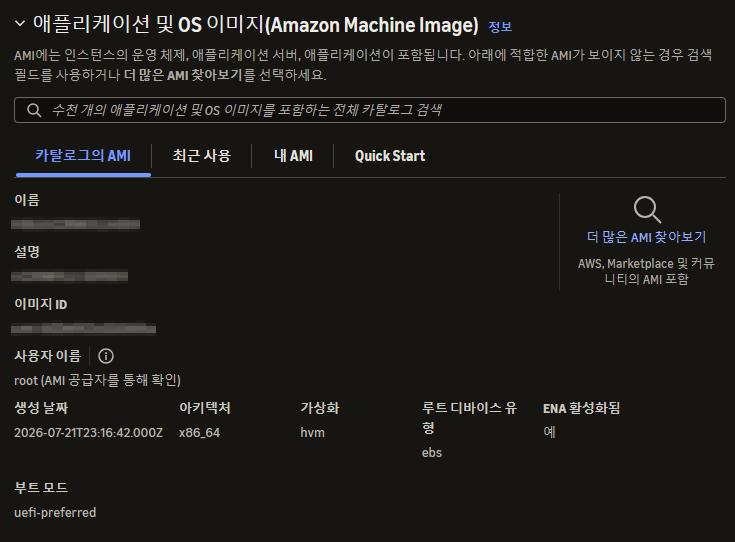

### 인스턴스 유형 선택

서버 사양을 고릅니다. **원본 서버와 같거나 비슷한 사양**으로 맞추세요(화면 예시는 t3.micro). 사양이 클수록 요금이 올라갑니다.

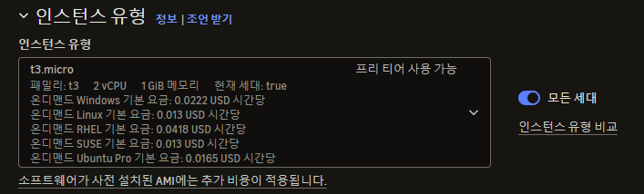

### 키 페어 선택

접속에 쓸 **키 페어**를 고릅니다. 리눅스는 이 키로 SSH 접속, 윈도우는 관리자 암호 복호화에 사용합니다. 키가 없으면 접속이 안 되니 반드시 가진 키를 고르세요.

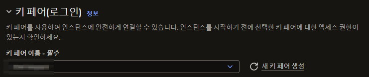

### 네트워크 설정

**VPC**와 **서브넷**을 고르고, **보안 그룹**을 정합니다. 내부망 전용 서버라면 **퍼블릭 IP 자동 할당은 '비활성화'**로 둡니다.

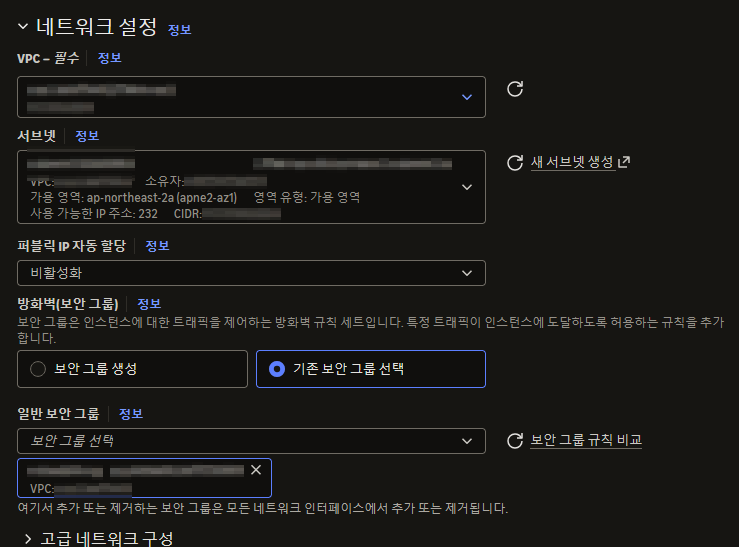

### (선택) 고정 사설 IP 지정

서버에 **고정 사설 IP**를 주고 싶으면 **고급 네트워크 구성**을 펼쳐 **기본 IP** 칸에 원하는 IP를 입력합니다. 반드시 위에서 고른 **서브넷 대역 안의 IP**여야 합니다. 자동 할당이면 비워 둡니다.

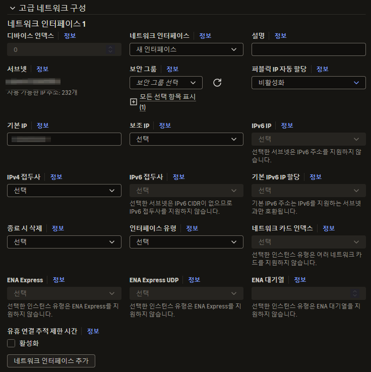

### 스토리지 확인

AMI에 들어 있던 디스크가 기본값으로 표시됩니다. 필요하면 **용량을 키울 수는 있지만 줄일 수는 없습니다**.

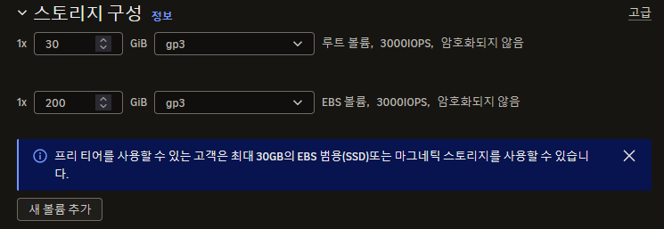

### 요약 확인 후 생성

오른쪽 **요약**에서 AMI, 인스턴스 유형, 보안 그룹, 스토리지가 맞는지 확인하고 **인스턴스 시작**을 누릅니다.

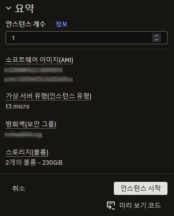

## 4단계 — 접속 확인

**인스턴스** 목록에서 새 서버의 **상태가 '실행 중(running)'**이 되고 **상태 검사(2/2)**를 통과했는지 확인합니다. 생성 직후 몇 분은 부팅 중일 수 있습니다.

- **리눅스**: 키 파일로 SSH 접속 — `ssh -i 키파일.pem 사용자계정@사설IP` (계정은 원본 서버와 동일). 내부망 서버면 같은 VPC의 다른 서버나 배스천을 거쳐 접속합니다.
- **윈도우**: RDP로 접속. 보안 그룹에 허용된 IP에서만 됩니다.

복제본이라 **접속 계정·비밀번호·키는 원본 서버와 같습니다**.

## 5단계 — 서비스 확인

복제된 서버는 원본의 프로그램이 그대로 들어 있어, 서비스가 자동 실행됐을 수 있습니다. 아래를 점검합니다.

- **서비스 상태**: `systemctl status <서비스명>` (리눅스) / 서비스 관리자(윈도우)
- **포트 열림 확인**: `ss -tnlp` 로 필요한 포트가 LISTEN 중인지
- **웹이면** 서버 안에서 `curl http://localhost` 로 응답 확인
- **애플리케이션 로그**에 에러가 없는지

### 복제 후 꼭 정리할 것

원본을 그대로 복제했기 때문에, **IP가 바뀌면서 안 맞는 설정**이 남아 있을 수 있습니다.

- 설정 파일·DB 접속 정보에 **옛 서버의 IP**가 박혀 있지 않은지
- 호스트명, `/etc/hosts`, `machine-id`, SSH 호스트키 등 복제 흔적 정리(리눅스)
- 윈도우는 Sysprep 없이 만든 AMI면 컴퓨터명·SID 중복 주의
- 보안 그룹에서 SSH(22)·RDP(3389)는 허용 IP 목록 기준으로만 열고, 전체(Any) 개방 규칙은 만들지 않기

## 부록 — AWS CLI로 하는 방법

위 콘솔 작업을 명령어로도 할 수 있습니다. 아래 값(ami-, sg-, subnet- 등)은 예시이니 실제 환경 값으로 바꿔 쓰세요.

### 1. 기존 서버에서 AMI 생성

```bash
aws ec2 create-image \
  --instance-id i-xxxxxxxxxxxxxxxxx \
  --name "MY-SERVER-AMI" \
  --description "my-server" \
  --no-reboot \
  --region ap-northeast-2
```

- `--instance-id`: 복제할 원본 서버 ID
- `--no-reboot`: 재부팅 없이 생성. 운영 중 서버면 편하지만 디스크 정합성이 떨어질 수 있으니 중요 DB는 정지 후 권장
- 실행하면 **ImageId(ami-...)**가 출력됩니다.

생성 완료(available) 확인:

```bash
aws ec2 describe-images --image-ids ami-xxxxxxxx \
  --region ap-northeast-2 --query "Images[0].State"
```

### 2. AMI로 EC2 인스턴스 생성

```bash
aws ec2 run-instances \
  --image-id ami-xxxxxxxxxxxxxxxxx \
  --instance-type t3.micro \
  --key-name my-keypair \
  --security-group-ids sg-xxxxxxxxxxxxxxxxx \
  --subnet-id subnet-xxxxxxxx \
  --private-ip-address 10.0.x.x \
  --no-associate-public-ip-address \
  --region ap-northeast-2 \
  --tag-specifications 'ResourceType=instance,Tags=[{Key=Name,Value=MY-WEB-SERVER-01}]'
```

옵션이 콘솔 단계와 1:1로 대응됩니다.

- `--image-id`: AMI / `--instance-type`: 인스턴스 유형 / `--key-name`: 키 페어
- `--security-group-ids`: 보안 그룹 / `--subnet-id`: 서브넷
- `--private-ip-address`: 고정 사설 IP(기본 IP) / `--no-associate-public-ip-address`: 퍼블릭 IP 비활성화

볼륨 크기를 키우려면 아래 옵션을 추가합니다.

```bash
  --block-device-mappings '[{"DeviceName":"/dev/xvda","Ebs":{"VolumeSize":100,"VolumeType":"gp3"}}]'
```

DeviceName은 AMI의 루트 디바이스명에 맞춰야 합니다(확인: describe-images의 RootDeviceName).

### 3. 생성된 서버 상태 확인

```bash
aws ec2 describe-instances --instance-ids i-xxxxxxxx \
  --region ap-northeast-2 \
  --query "Reservations[0].Instances[0].State.Name"
```
