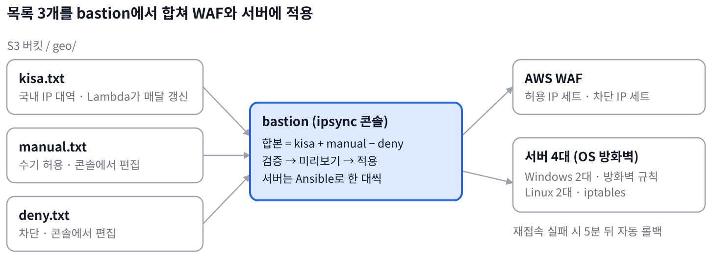
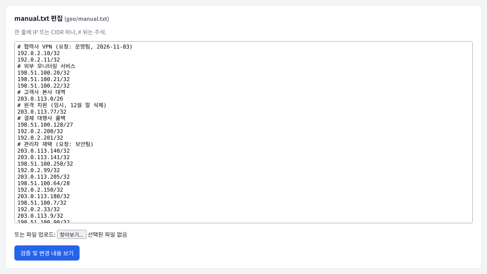
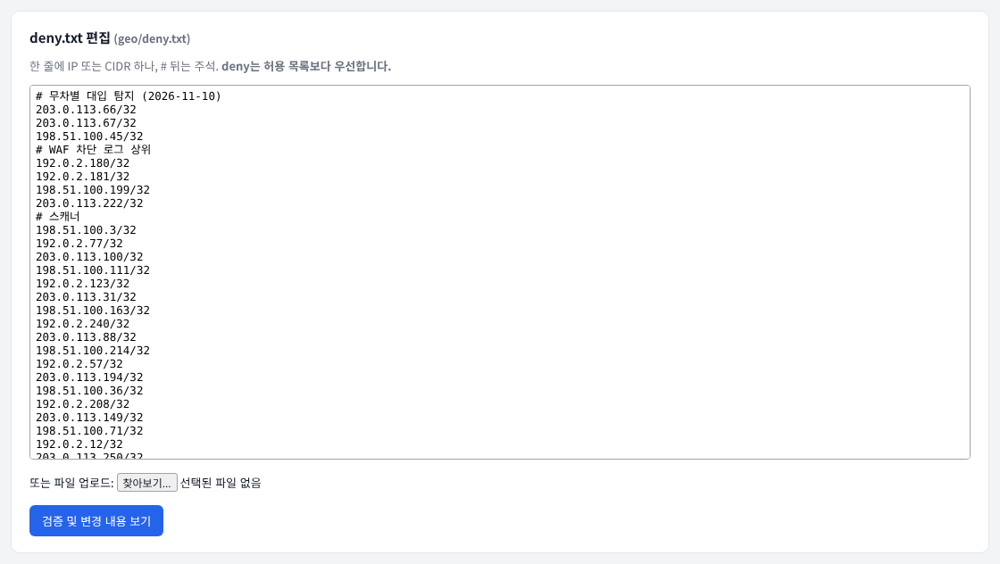
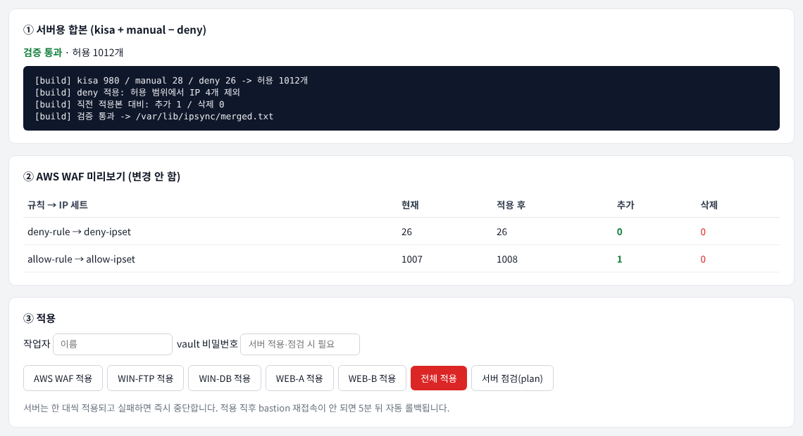
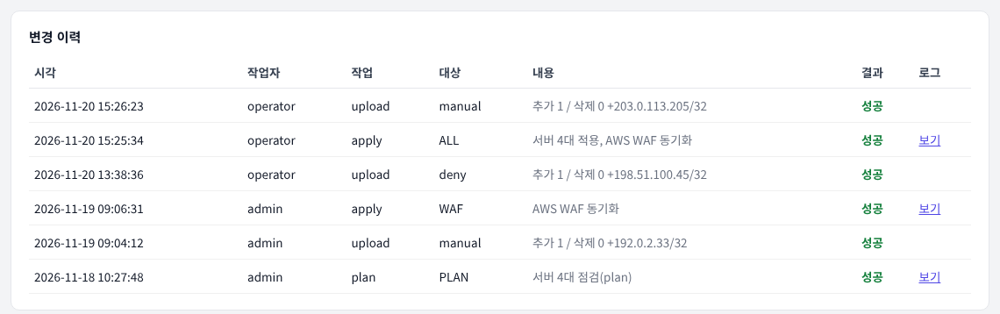
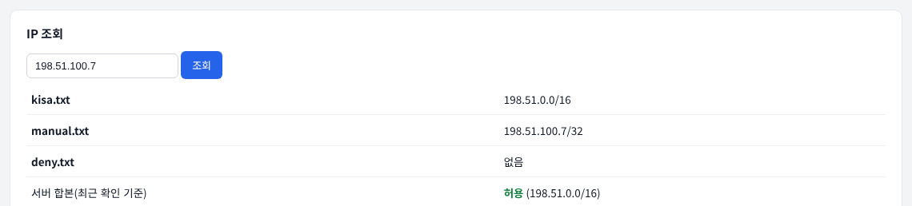

+++
title = "허용 IP 목록을 웹에서 관리하기 — ipsync 콘솔 사용법"
date = 2026-11-26
[taxonomies]
tags = ["aws", "waf", "ansible", "security"]
+++

서버 방화벽과 AWS WAF에 들어가는 허용·차단 IP를 웹 화면 하나에서 고치고, 검증한 뒤, 버튼 한 번으로 모두 반영하는 도구(ipsync 콘솔)의 사용법을 정리합니다.

- 목록은 **S3에 있는 텍스트 파일 3개**(kisa / manual / deny)뿐입니다.
- 콘솔은 **bastion 서버**에서 돌고, 실제 반영은 bastion의 **Ansible**이 합니다.
- 사용하는 사람은 목록을 고치고 → 검증 결과를 보고 → 적용 버튼만 누르면 됩니다.

> 이 글의 화면은 설명용으로 다시 만든 것입니다. IP는 문서용 예약 대역(192.0.2.0/24, 198.51.100.0/24, 203.0.113.0/24), 서버 이름은 예시입니다.

<!-- more -->

## 왜 만들었나

허용 IP 요청이 오면 Windows 서버 2대, Linux 서버 2대, AWS WAF에 같은 IP를 각각 넣어야 했습니다. 손으로 다섯 군데를 고치다 보니 한 곳이 빠지거나, 지운 IP가 어딘가 남는 일이 생겼습니다.

그래서 기준 목록을 S3 한 곳에만 두고, 모든 대상이 그 목록에서 만들어진 **같은 합본**을 받도록 바꿨습니다. 국내 IP 대역(KISA 공개 데이터)은 Lambda가 매달 자동으로 갱신합니다.

## 동작 원리

허용 목록은 항상 **kisa + manual − deny** 하나로 만들어져 WAF와 서버에 똑같이 들어갑니다.

| 파일 | 내용 | 누가 고치나 |
| --- | --- | --- |
| kisa.txt | 국내 IP 대역 | Lambda가 매달 자동 갱신 (손대지 않음) |
| manual.txt | 따로 허용할 IP (협력사, 모니터링, 원격 지원 등) | 콘솔에서 편집 |
| deny.txt | 차단할 IP | 콘솔에서 편집, **허용보다 우선** |

WAF는 AWS API로 IP 세트를 갱신하고, 서버는 Ansible이 한 대씩 OS 방화벽(Windows 방화벽, iptables)을 바꿉니다.

## 메뉴 구성

| 메뉴 | 하는 일 |
| --- | --- |
| 대시보드 | 목록 개수와 최근 적용 상태 |
| manual.txt | 수기 허용 IP 편집 |
| deny.txt | 차단 IP 편집 |
| 확인·적용 | 합본 검증, WAF 변경 미리보기, 적용, 서버 점검(plan) |
| 이력 | 누가 언제 무엇을 바꾸고 적용했는지, 적용 로그 |
| IP 조회 | IP 하나가 어느 목록에 있고 최종적으로 허용인지 |

IP를 고치는 화면은 manual.txt와 deny.txt 두 개뿐이고, 실제 반영은 **확인·적용**에서만 일어납니다.

## 자주 하는 작업

### 허용 IP 추가

1. **manual.txt**에서 맨 아래에 IP를 한 줄 추가합니다. 예: `203.0.113.205/32  # 원격 지원, 12월 말 삭제`
2. **검증 및 변경 내용 보기**를 눌러 추가·삭제될 IP가 맞는지 확인하고 저장합니다.
3. **확인·적용**에서 ① 합본이 **검증 통과**인지, ② WAF 추가 건수가 예상과 같은지 봅니다.
4. 작업자 이름과 vault 비밀번호를 넣고 **전체 적용**을 누릅니다.
5. **이력**에서 결과가 **성공**인지 확인합니다.

### 차단 IP 추가

1. **deny.txt**에 IP를 추가하고 **검증 및 변경 내용 보기**로 저장합니다.
2. **확인·적용**에서 ①의 "deny 적용: 허용 범위에서 IP n개 제외"와 ②의 차단 IP 세트 추가 건수를 확인합니다.
3. **전체 적용**을 누릅니다. 웹만 막으면 되는 경우 **AWS WAF 적용**만 눌러도 됩니다.

### 특정 IP가 허용돼 있는지 확인

**IP 조회**에 IP를 넣고 **조회**를 누르면, 세 목록 중 어디에 걸리는지와 최종 결과(허용/차단)가 나옵니다.

## 화면별 사용법

### manual.txt / deny.txt

한 줄에 IP 또는 CIDR 하나씩 쓰고, `#` 뒤는 주석입니다. 요청자와 날짜를 주석으로 남겨 두면 나중에 정리하기 쉽습니다. 텍스트 파일을 올려 통째로 바꿀 수도 있습니다.

deny.txt도 쓰는 법은 같습니다. 여기 들어간 IP는 허용 목록에 있어도 차단됩니다.

**검증 및 변경 내용 보기**는 형식을 검사하고 추가·삭제될 IP를 보여준 뒤 S3에 저장합니다. 이 단계에서는 서버와 WAF가 바뀌지 않습니다.

### 확인·적용

화면 위에서부터 ① → ② → ③ 순서로 봅니다.

| 영역 | 보는 것 |
| --- | --- |
| ① 서버용 합본 | 목록별 건수, 최종 허용 개수, 직전 적용본 대비 추가/삭제, **검증 통과** 여부 |
| ② AWS WAF 미리보기 | 허용·차단 IP 세트의 현재/적용 후 개수, 추가·삭제 건수 (보기만 함) |
| ③ 적용 | 작업자·vault 비밀번호 입력 후 대상별 버튼 또는 전체 적용 |

| 버튼 | 하는 일 |
| --- | --- |
| AWS WAF 적용 | WAF IP 세트만 갱신 (vault 비밀번호 불필요) |
| 서버별 적용 | 해당 서버 한 대만 갱신 |
| 전체 적용 | WAF + 서버 4대 (보통 이 버튼) |
| 서버 점검(plan) | 실제로 바꾸지 않고, 적용하면 서버별로 무엇이 바뀔지만 확인 |

작업자 이름은 이력에 그대로 남으니 본인 이름이나 계정을 넣습니다.

### 이력

upload(목록 저장), apply(적용), plan(점검)이 최신순으로 나오고, apply·plan은 **보기**로 실행 로그를 열 수 있습니다.

### IP 조회

세 목록에서 그 IP를 포함하는 항목과, 마지막 줄에 최종 결과를 보여줍니다. 아래 예시는 kisa 대역과 manual 양쪽에 걸려 **허용**입니다. "최근 확인 기준"은 마지막으로 확인·적용 화면을 열었을 때 만든 합본이라는 뜻입니다.

## 주의사항

- **deny가 허용보다 우선합니다.** 허용했는데 안 된다는 문의가 오면 IP 조회부터 확인합니다.
- **검증 통과가 아니면 적용하지 않습니다.** 오류가 난 줄의 형식(IP/CIDR)을 고친 뒤 다시 저장합니다.
- **건수가 크게 바뀌면 멈춥니다.** 한두 줄 고쳤는데 삭제가 수십 건이면 목록이 잘못 올라간 것입니다.
- **서버는 한 대씩 적용되고, 실패하면 그 자리에서 멈춥니다.** 앞서 성공한 서버만 새 목록이 되니, 이력의 로그에서 실패 서버와 이유를 확인합니다.
- **자동 롤백:** 적용 직후 bastion에서 서버로 다시 접속되지 않으면 5분 뒤 그 서버 방화벽이 이전 상태로 돌아갑니다. 잘못 적용해도 관리 접속이 끊긴 채로 남지 않습니다.
- **처음이거나 큰 변경이면** 서버 점검(plan)으로 변경 내용을 먼저 봅니다.
- **kisa.txt는 손대지 않습니다.** 매달 덮어써지므로 필요한 IP는 항상 manual.txt에 넣습니다.
